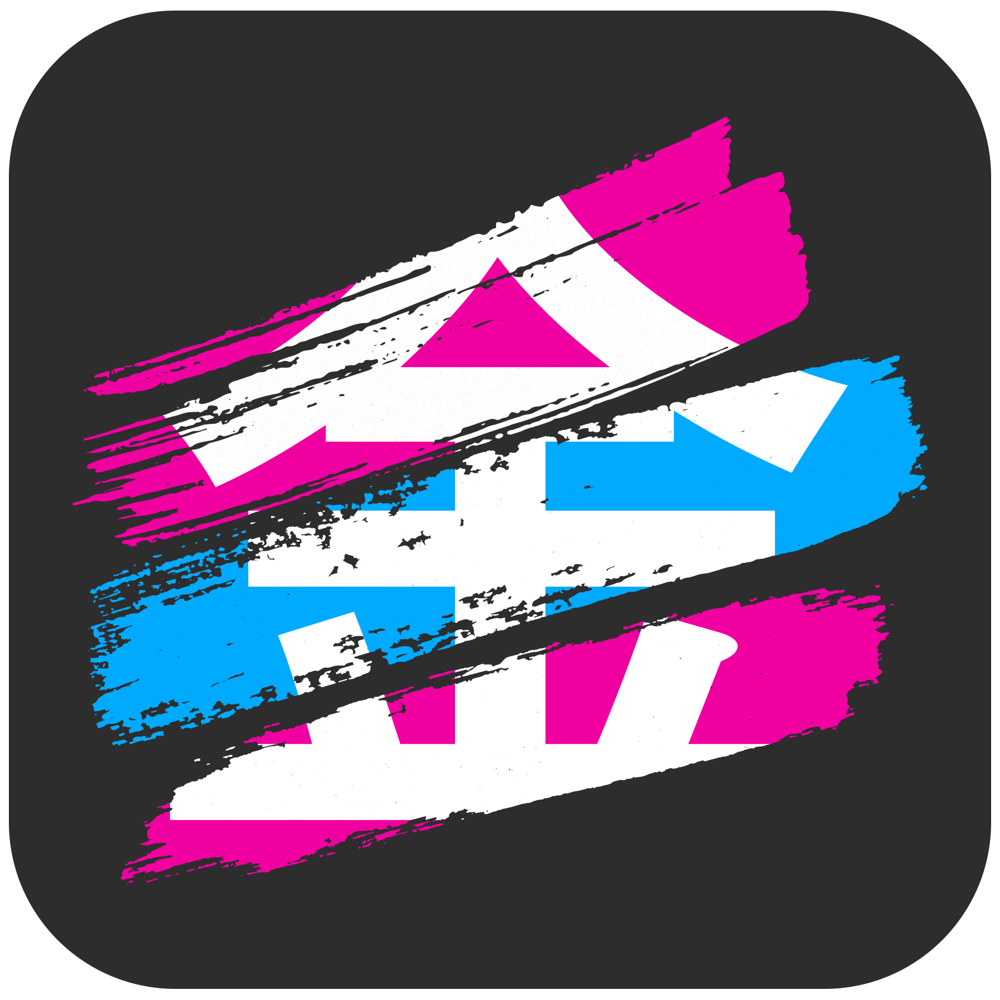

# WaniKani Kanji Highlighter

<p align="center">
  
</p>

<p align="center">
   Browser extension that highlights the kanji and words you study with WaniKani on any web page (unofficial extension).
</p>

<p align="center">
   <a href="https://github.com/digas99/wanikani-kanji-highlighter/actions/workflows/codeql.yml"></a>
   <a href="https://github.com/digas99/wanikani-kanji-highlighter/actions/workflows/deploy-extension.yml"></a>
   <a href="https://github.com/digas99/wanikani-kanji-highlighter/blob/dev/package.json"></a>
   <a href="https://github.com/digas99/wanikani-kanji-highlighter/blob/master/LICENSE"></a>
   <a href="https://github.com/digas99/wanikani-kanji-highlighter/blob/dev/wxt.config.ts"></a>
<br>
   <a href="https://chrome.google.com/webstore/detail/wanikani-kanji-highlighte/pdbjikelneighjgjojikkmhiehpcokjm"></a>
   <a href="https://chrome.google.com/webstore/detail/wanikani-kanji-highlighte/pdbjikelneighjgjojikkmhiehpcokjm"></a>
   <a href="https://addons.mozilla.org/en-US/firefox/addon/wanikani-kanji-highlighter/"></a>
   <a href="https://addons.mozilla.org/en-US/firefox/addon/wanikani-kanji-highlighter/"></a>
   <a href="https://microsoftedge.microsoft.com/addons/detail/wanikani-kanji-highlighte/bojpejhgjpipdejiphdgmikcojkhcfpl"></a>
   <a href="https://microsoftedge.microsoft.com/addons/detail/wanikani-kanji-highlighte/bojpejhgjpipdejiphdgmikcojkhcfpl"></a>
</p>

---

<p align="center">
   <a href="https://chrome.google.com/webstore/detail/wanikani-kanji-highlighte/pdbjikelneighjgjojikkmhiehpcokjm"></a>
   <a href="https://addons.mozilla.org/en-US/firefox/addon/wanikani-kanji-highlighter/"></a>
   <a href="https://microsoftedge.microsoft.com/addons/detail/wanikani-kanji-highlighte/bojpejhgjpipdejiphdgmikcojkhcfpl"></a>
</p>

---

### Unofficial Browser Extension

This is an unofficial browser extension that highlights kanji and words on any web page, matched against what you study on [WaniKani.com](https://www.wanikani.com/). Hover a highlight to see its meanings, readings, mnemonics, stroke order and your own stats.

**Because it would be "cheating", nothing is highlighted on [WaniKani.com](https://www.wanikani.com/) itself.** There, the extension only offers [optional review tools](#on-wanikani), all off by default.

## Table of contents

1. [What's New in v2.0.0](#whats-new-in-v200)
2. [Usage Guide](#usage-guide)
   - 2.1. [WaniKani API Token](#wanikani-api-token)
   - 2.2. [Highlighting](#highlighting)
   - 2.3. [Subject Details](#subject-details)
     - 2.3.1. [Shortcut Keys](#shortcut-keys)
   - 2.4. [Page Reading Level](#page-reading-level)
   - 2.5. [Subject Search](#subject-search)
   - 2.6. [Writing Kana](#writing-kana)
   - 2.7. [Lessons, Reviews and Progress](#lessons-reviews-and-progress)
   - 2.8. [On WaniKani](#on-wanikani)
   - 2.9. [Choosing Where It Runs](#choosing-where-it-runs)
   - 2.10. [Settings](#settings)
   - 2.11. [Troubleshooting](#troubleshooting)
3. [Building from Source](#building-from-source)

## What's New in v2.0.0

Version 2.0.0 is a complete rewrite, and your settings, API key and site lists carry over from v1.5 automatically. The highlights:

- **Words are highlighted too**, including conjugated forms (話していました → 話す) and pages with furigana
- **Color highlights** by learned / not learned, SRS stage, JLPT level or Jōyō grade
- **Page reading level**: a page's JLPT level and how much of it you know, with an optional history of the pages you read
- **Example sentences** from the pages you read, with private on-device translation and Anki export
- **Review session summary** on WaniKani, plus optional info and a timer during reviews
- **New Home**: today's activity, a recap of yesterday, an activity calendar and a layout you can customize
- **New pages**: Practice, Trouble subjects, Reviewed, Friends, Accolades and JLPT & Jōyō progress
- **Level-up and workload projections**, so you can see what's coming and when
- **Backups** of your settings and history to a file or Google Drive

#### [(All changelogs)](CHANGELOG.md)

## Usage Guide

### WaniKani API Token

The extension needs a WaniKani API token to know what you've learned. It only reads your data, so a token with WaniKani's default permissions (no write access) is all it needs.

1. Open the extension popup and click **Find API Key**, or go to [your API tokens on WaniKani](https://www.wanikani.com/settings/personal_access_tokens).
2. Generate a new token. Give it any name you want.
3. Click **Send key** next to the token, then **Login** in the popup. You can also paste the token into the popup yourself.

If you backed up your API key to Google Drive, you can use **Log in with Google Drive** instead.

### Highlighting

Kanji and words you study on WaniKani are highlighted on any page, including pages that change as you use them, like YouTube. There are three modes:

- **Kanji**: only kanji
- **Words**: only words
- **Mixed**: words, and the kanji outside them

Highlights can be colored by learned / not learned, SRS stage, JLPT level or Jōyō grade. You'll find these options in _Settings → Highlight_.

### Subject Details

Hover a highlight and a small preview opens in the bottom-right corner of the page. Move onto it to open the full details: meanings, readings with pitch accent, mnemonics, stroke order, related subjects and your stats.

Hovering another highlight updates the popup, and clicking outside it closes it. The popup's **⋯** menu changes that:

- **Lock subject**: hovering other highlights won't change it
- **Keep open**: clicking outside won't close it
- **Key bindings**: turns the shortcut keys below on or off

Click the characters to copy them.

Prefer the details next to the page? Set _Settings → Details → Show subject details_ to **Browser side panel**. Clicking a highlight then opens it there, and hovering updates it.

#### Shortcut Keys

| Key | Description |
| ------- | ----------- |
| **X** | Close the popup. |
| **L** | Lock the subject, so hovering other highlights won't change it. |
| **O** | Expand the small preview. |
| **F** | Keep the popup open when clicking outside it. |
| **B** | Go back to the previous subject. |
| **Y** | Copy the subject's characters. |
| **U** | Scroll back to the top. |
| **I** | Go to the Info section. |
| **C** | Go to the Cards section. |
| **S** | Go to the Statistics section. |
| **T** | Go to the Timestamps section. |
| **←** | Go to the previous section. |
| **→** | Go to the next section. |

**O** works on the small preview. **F**, **B**, **Y**, **U**, **I**, **C**, **S**, **T** and the arrows work once the popup is expanded.

These shortcuts can collide with ones the page already has. They're ignored while you type in a field or hold Ctrl, Alt or Cmd.

### Page Reading Level

Turn this on in _Settings → Reading_ for a small bar in the corner of pages with Japanese. It shows the page's **JLPT level** and how much of its kanji and words you know, from **Easy** to **Hard**. Click it for the Learned, SRS, JLPT and Jōyō breakdowns.

- **Choose parts…** rates only parts of a site, like an article's text, on all its pages. **Focus** then dims everything else.
- **Page history** keeps the pages you read, to sort and filter by difficulty. It stays in your browser unless you back it up yourself.
- **Example sentences** are kept from the pages you read and shown on each subject. They also have their own library, on-device translation and Anki export, and you can leave out specific sites.

### Subject Search

You can search for any subject taught on WaniKani, even if you haven't learned it yet. On the popup's Home, just start typing and the search opens with what you typed.

Search in one of two ways, switching with the **あ** / **A** button:

- **Kana (きん):** type a reading to see the subjects that have it
- **Romaji, kanji or a number (Gold / 金 / 5):**
  - **Meaning:** shows every match, since different subjects can share a name
  - **Characters:** shows that subject and related ones, like similar kanji and the words that use it
  - **Level:** shows every subject from that level

Filters narrow the results by subject type (**Radicals**, **Kanji**, **Vocabulary**) and by progress (**Passed**, **Learning**, **Locked**). **Precise** searches exactly for what you typed, so "gold" won't also find "goldfish". Results can be shown in different layouts.

Search **legacy** to list the subjects WaniKani retired, which no longer appear in lessons or reviews.

You can also search from any page. Select some text, right-click and pick **Search**, and the search is waiting the next time you open the extension. With the popup popped out into its own window (**Popout** in the sidebar), just selecting text searches it right away.

### Writing Kana

When the search bar is in kana mode (**あ**), what you type is converted to kana as you go. **Lower case** gives **hiragana** and **ALL CAPS** gives **katakana**.

So **kya** becomes **きゃ**, and **KYA** becomes **キャ**.

Special characters, which work the same way in katakana:

| To write | Type | Example |
| ------- | ----------- | ------- |
| **ぁぃぅぇぉ** (small) | x or l + a, i, u, e, o | **xa** → ぁ |
| **ゃゅょ** (small) | x or l + ya, yu, yo | **xya** → ゃ |
| **っ** (small) | a double consonant, or xtu / ltu | **kka** → っか |
| **ん** | nn or n' | **nn** → ん |

### Lessons, Reviews and Progress

The popup's Home shows how many lessons and reviews you have, when more are coming, and today's reviews, accuracy, lessons and SRS moves. Hover or click the SRS moves to see them on the Progress overview tiles. **Customize home** at the bottom reorders or hides its sections.

From there you can reach:

- **Lessons:** the subjects in your queue, and what's coming next
- **Reviews:** a chart of future reviews, and a workload forecast for the coming days
- **Reviewed:** the subjects you reviewed each day, as tiles or with their SRS changes
- **Levels:** projections to level 60, JLPT and Jōyō, at your pace or a custom one
- **Profile:** your level-up path, with what to review and when you can level up
- **Practice:** the **▶** button on a list practices its subjects as flashcards, and **Practice** beside the level bar starts on what you need to level up
- **Trouble subjects:** the Apprentice subjects you keep getting wrong, marked with a **!** on their tiles, until you get them right a few times in a row
- **JLPT & Jōyō:** your progress through each level and grade
- **Friends:** follow up to 15 WaniKani friends' levels and progress, from their public profiles
- **Accolades:** badges for your milestones, and a small celebration when you level up
- **Notifications:** the sidebar's bell keeps your level-ups, accolades, friends' news and daily summaries

### On WaniKani

Nothing is highlighted on WaniKani, but these optional tools work on its pages. Turn them on in _Settings → Details_:

- **Subject info while reviewing:** the subject's SRS stage, level, JLPT and Jōyō, your accuracy, the last answer's SRS change, and a context sentence or example words. It never shows the answer.
- **Session summary:** after your reviews, what went up, down or stayed, your accuracy per subject, what you passed, your trouble subjects and your level's progress. Hover a subject for its card.
- **Review timer:** a countdown, then Wrap Up.

They work with Double-Check, counting changed or retyped answers the way WaniKani does.

### Choosing Where It Runs

If the extension causes problems on a site, or you'd rather not have it there, use **Blacklist site** in the popup's sidebar. The same button then becomes **Enable highlighting here**, to allow it again.

Prefer it only on certain sites? Set _Settings → Highlight → Site access → Default behaviour_ to **Only listed sites**. The sidebar button then adds sites to a whitelist instead.

Both lists can be edited in _Site access_.

### Settings

Click the gear icon in the popup's sidebar. Settings are organized in tabs:

- **Highlight:** turn highlighting on or off, its mode, what's highlighted and how it's colored, the highlight style, and site access
- **Reading:** the page reading level bar, page history and example sentences
- **Details:** the details popup (where it opens, opacity, width, subject drawing, audio autoplay), the random subject type, and the [tools on WaniKani](#on-wanikani)
- **Popup:** Home's sections, the popup interface and search defaults
- **Theme:** colors for highlights, subject types and SRS stages, with presets
- **General:** browser notifications (new reviews, a daily reminder at the time you choose, searching a word from a page) and the extension icon
- **Data:** backups to a file or Google Drive, the subject cache, and **Reset subject data**

### Troubleshooting

**Something looks off.** If highlights look wrong, a subject won't load, or something broke after updating to 2.0, use **Reset subject data** in _Settings → Data_. It removes anything left over from the previous version and downloads your subjects again. Your settings, API key and saved history are kept, and your WaniKani account isn't affected.

**Notifications don't show up.** Your system may be holding them back: check **Do not disturb** or **Focus**, including modes that turn on by themselves in full screen or when sharing your screen, and that the browser's notifications are on in your system settings. They may also be waiting in the notification centre.

## Building from Source

The extension is built with [WXT](https://wxt.dev/), Vue 3, Pinia and TypeScript. It gets its WaniKani data through the [wanikani-api-manager](https://github.com/digas99/wanikani-api-manager) library.

You need [Node.js](https://nodejs.org/) and npm. Clone both repositories side by side, keeping the library's default folder name, because the extension installs it from `../wanikani-api-manager`:

```sh
git clone https://github.com/digas99/wanikani-api-manager.git
git clone --branch dev https://github.com/digas99/wanikani-kanji-highlighter.git

# build the library first: the extension uses its built files
cd wanikani-api-manager
npm install
npm run build:lib

# then build the extension
cd ../wanikani-kanji-highlighter
npm install
npm run build
```

Then load the build into your browser:

| Browser | Build command | Output | How to load it |
| ------- | ------------- | ------ | -------------- |
| Chrome, Edge, Brave | `npm run build` | `.output/chrome-mv3` | In the extensions page, turn on Developer mode, click **Load unpacked** and pick the folder |
| Firefox | `npm run build:firefox` | `.output/firefox-mv2` | In `about:debugging`, open **This Firefox**, click **Load Temporary Add-on** and pick the folder's `manifest.json` |

For development, `npm run dev` and `npm run dev:firefox` run the extension with live reloading. After changing the library, run `npm run build:lib` in its folder again so the extension picks up the changes.
